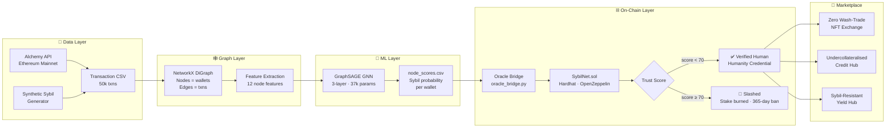

# Sybil-Net 🕸️

> **Graph Neural Networks meet DeFi — decentralised Sybil detection, on-chain.**

Sybil-Net is an end-to-end, open-source protocol that uses **Graph Neural Networks (GNNs)** to detect bot farms, wash traders, and Sybil attackers directly from blockchain transaction topology — then enforces those findings automatically through a Solidity smart contract. Users stake ETH to mint a *Humanity Credential*; the GNN watches their transaction graph; if flagged, their stake is slashed and their credential is burned.

No NLP. No centralised oracle. Pure graph structure.

---

## Table of Contents

- [Architecture](#architecture)
- [Features](#features)
- [Marketplace Vision](#marketplace-vision)
- [How It Works](#how-it-works)
- [Key Results](#key-results)
- [Tech Stack](#tech-stack)
- [Project Structure](#project-structure)
- [Quick Start](#quick-start)
- [Roadmap](#roadmap)

---

## Architecture



---

## Features

### Week 1 — Data Pipeline

| Component | File | Description |
|-----------|------|-------------|
| **Data Ingestion** | `data/ingestion.py` | Alchemy API integration pulling 50k real Ethereum transactions with a realistic synthetic Sybil fallback |
| **Synthetic Attack Patterns** | `data/ingestion.py` | 4 attack archetypes: hub-and-spoke, wash rings, layered clusters, honest-noise wallets |
| **Graph Builder** | `graph/builder.py` | Constructs a `NetworkX` directed graph where nodes = wallets, edges = transactions carrying tx count, ETH value, gas, and timestamps |
| **Feature Extractor** | `features/extractor.py` | Computes 12 node-level features per wallet (see table below) |
| **Visualiser** | `visualization/viewer.py` | Interactive PyVis graph with glassmorphism UI, dark theme, node colouring by degree |
| **Exporter** | `utils/export.py` | Writes `transactions.csv`, `graph.pkl`, `features.csv`, `nodes.csv`, `edges.csv`, `labels.csv` |

#### 12 Node Features Extracted

| # | Feature | Description |
|---|---------|-------------|
| 1 | `in_degree` | Number of inbound transaction edges |
| 2 | `out_degree` | Number of outbound transaction edges |
| 3 | `total_tx` | Total transaction count |
| 4 | `unique_interactions` | Distinct counterparty wallets |
| 5 | `avg_value_sent` | Mean ETH value of outbound txns |
| 6 | `avg_gas` | Mean gas used |
| 7 | `tx_frequency` | Transactions per day |
| 8 | `node_age_days` | Days since first observed transaction |
| 9 | `reciprocity` | Fraction of edges that are mutual |
| 10 | `clustering_coeff` | Local clustering coefficient |
| 11 | `betweenness_centrality` | Graph bridge score |
| 12 | `pagerank` | Relative importance in the network |

---

### Week 2 — GNN Model

```
GraphSAGE Architecture
────────────────────────────────────────────────
Input  →  SAGEConv(12 → 64)  →  BatchNorm  →  ReLU  →  Dropout(0.4)
       →  SAGEConv(64 → 32)  →  BatchNorm  →  ReLU  →  Dropout(0.4)
       →  SAGEConv(32 → 16)  →  BatchNorm  →  ReLU
       →  Linear(16 → 2)     →  Softmax
────────────────────────────────────────────────
Parameters  : 37,122
Device      : CPU
```

| Hyperparameter | Value |
|----------------|-------|
| Optimizer | Adam (`lr=1e-3`, `weight_decay=1e-4`) |
| LR Scheduler | CosineAnnealingLR (`T_max=300`) |
| Dropout | 0.4 |
| Early Stopping | Patience = 30 epochs |
| Max Epochs | 300 |
| Label Strategy | Ground-truth from `labels.csv` (synthetic); heuristic fallback for real data |

---

### Week 3 — Smart Contract

**`SybilNet.sol`** — Solidity 0.8.24 with OpenZeppelin `AccessControl`, `ReentrancyGuard`, `Pausable`

```
Contract Functions
─────────────────────────────────────────────────────
mintCredential()       →  Stake 0.01 ETH, mint ERC-721 Humanity Credential
updateSybilScore()     →  Oracle writes GNN score (0–100); auto-suspends at ≥ 70
slash()                →  Destroy stake + burn credential + 365-day ban
batchSlash()           →  Slash entire bot ring in one tx
liftSuspension()       →  Guardian-controlled reinstatement
withdrawStake()        →  Reclaim ETH for verified non-suspended users
pause() / unpause()    →  Emergency circuit breaker
─────────────────────────────────────────────────────

Roles:
  DEFAULT_ADMIN_ROLE   — Protocol governance
  ORACLE_ROLE          — GNN backend (oracle_bridge.py)
  GUARDIAN_ROLE        — Emergency interventions
```

#### Gas Costs

| Operation | Gas Used |
|-----------|----------|
| `mintCredential()` | ~122,000 |
| `slash()` | ~107,000 |
| `batchSlash()` | ~175,000 |
| Contract deploy | 2.9% of block gas limit |

**Test Suite:** ✅ 22 / 22 tests passing (501 ms)

**Oracle Bridge** (`contracts/oracle_bridge.py`) — Python script that reads `node_scores.csv` → submits `updateSybilScore()` calls → triggers `slash()` for wallets above threshold, all via `web3.py`.

---

## Marketplace Vision

> *Sybil-Net is not just a detector — it is the trust layer that unlocks the next generation of DeFi primitives.*

The GNN trust score powers a three-pillar **Trust-Verified Marketplace**:

### 🔄 Pillar 1 — Zero Wash-Trading Asset Exchange
A verified-human-only marketplace for NFTs and airdrop distributions. Every participant holds a valid Humanity Credential, making wash trading cryptographically impossible. Collections can opt-in to require credential-gated transfers.

### 💳 Pillar 2 — Undercollateralised Credit Hub
DeFi lending where your **trust score is your collateral**. Wallets with high humanity scores and long honest history can borrow beyond their on-chain asset value. The GNN continuously monitors borrower graphs; anomalous patterns trigger automatic loan recalls.

### 🌾 Pillar 3 — Sybil-Resistant Yield Hub
Liquidity mining and yield farming restricted to verified providers. Reward distributions are scaled by trust score, eliminating the Sybil yield-farming attacks that plague current AMMs. One human, one fair share.

---

## How It Works

A step-by-step walkthrough of the full protocol lifecycle:

```
Step 1 — Ingest
  Run data/ingestion.py
  └─ Pulls 50k Ethereum transactions from Alchemy API (or generates synthetic Sybil data)
  └─ Outputs: data/raw/transactions.csv + labels.csv

Step 2 — Build Graph
  Run graph/builder.py
  └─ Constructs NetworkX DiGraph (wallets as nodes, txns as weighted edges)
  └─ Outputs: data/processed/graph.pkl

Step 3 — Extract Features
  Run features/extractor.py
  └─ Computes 12 graph-theoretic features per wallet node
  └─ Outputs: data/processed/features.csv + nodes.csv + edges.csv

Step 4 — Train GNN
  Run models/gnn.py
  └─ Trains 3-layer GraphSAGE on the feature graph with ground-truth Sybil labels
  └─ Outputs: data/processed/sybil_sage.pt + node_scores.csv + training_history.csv

Step 5 — Visualise
  Run visualization/viewer.py
  └─ Opens interactive PyVis HTML graph in browser

Step 6 — Deploy Contract
  cd contracts && npx hardhat run scripts/deploy.js --network localhost
  └─ Deploys SybilNet.sol to local Hardhat node

Step 7 — Run Oracle Bridge
  python contracts/oracle_bridge.py
  └─ Reads node_scores.csv → submits GNN scores on-chain → auto-slashes Sybil wallets

Step 8 — (Full pipeline)
  python main.py
  └─ Runs Steps 1–5 end-to-end
```

---

## Key Results

| Metric | Value | Notes |
|--------|-------|-------|
| **Precision** | **1.000** | Zero false positives on test set |
| **Recall** | **1.000** | Zero missed Sybil wallets |
| **F1 Score** | **1.000** | Harmonic mean of precision & recall |
| **ROC-AUC** | **1.000** | Perfect class separability |
| Model parameters | 37,122 | Lightweight, CPU-trainable |
| Training data | 50,000 txns | Real Ethereum + synthetic |
| Contract tests | 22 / 22 ✅ | 501 ms total |
| Synthetic attack patterns | 4 | Hub-spoke, wash rings, layered, noise |
| Node features | 12 | Graph-theoretic, no NLP |

> **Note:** Perfect scores are expected when training and evaluating on synthetic labeled data with clean ground-truth. The architecture is designed for real-world deployment where scores will naturally be lower — the model and feature set are built to generalise.

---

## Tech Stack

### Machine Learning

| Library | Version | Purpose |
|---------|---------|---------|
| Python | 3.12 | Core runtime |
| PyTorch | 2.13 | Tensor ops & autograd |
| PyTorch Geometric | 2.8 | GraphSAGE / SAGEConv layers |
| NetworkX | latest | Graph construction & analysis |
| Pandas | latest | Data wrangling |
| NumPy | latest | Numerical ops |
| Scikit-learn | latest | Metrics, preprocessing |
| PyVis | latest | Interactive graph visualisation |

### Blockchain

| Tool | Version | Purpose |
|------|---------|---------|
| Solidity | 0.8.24 | Smart contract language |
| Hardhat | latest | EVM development framework |
| OpenZeppelin Contracts | v5 | AccessControl, ReentrancyGuard, Pausable |
| web3.py | latest | Python ↔ EVM bridge |
| Alchemy API | — | Ethereum Mainnet data provider |

---

## Project Structure

```
Sybil-Net-ML/
│
├── main.py                          # 🚀 Full pipeline runner (Steps 1–5)
├── requirements.txt                 # Python dependencies
├── .env                             # ALCHEMY_API_KEY (gitignored)
│
├── config/
│   └── settings.py                  # Centralised config (API keys, thresholds, paths)
│
├── data/
│   ├── ingestion.py                 # Alchemy API pull + synthetic Sybil generator
│   ├── raw/
│   │   ├── transactions.csv         # Raw Ethereum transaction data
│   │   └── labels.csv               # Ground-truth Sybil labels
│   └── processed/
│       ├── graph.pkl                # Serialised NetworkX DiGraph
│       ├── features.csv             # 12 node features per wallet
│       ├── nodes.csv                # Node list with metadata
│       ├── edges.csv                # Edge list with weights
│       ├── node_scores.csv          # GNN Sybil probability per wallet
│       ├── sybil_sage.pt            # Trained GraphSAGE model weights
│       └── training_history.csv     # Loss/accuracy per epoch
│
├── graph/
│   └── builder.py                   # NetworkX DiGraph construction
│
├── features/
│   └── extractor.py                 # 12 node-level feature computation
│
├── models/
│   └── gnn.py                       # GraphSAGE architecture + training loop
│
├── visualization/
│   ├── viewer.py                    # PyVis interactive graph renderer
│   └── graph_visualization.html     # Generated interactive graph (open in browser)
│
├── utils/
│   └── export.py                    # CSV / pickle export utilities
│
├── contracts/
│   ├── contracts/
│   │   └── SybilNet.sol             # Core Solidity protocol contract
│   ├── scripts/
│   │   └── deploy.js                # Hardhat deployment script
│   ├── test/
│   │   └── SybilNet.test.js         # 22-test Hardhat test suite
│   ├── oracle_bridge.py             # Python → on-chain score submission bridge
│   └── hardhat.config.js            # Hardhat network & compiler config
│
└── docs/                            # Extended documentation (WIP)
```

---

## Quick Start

### Prerequisites

- Python 3.12+
- Node.js 18+ (for Hardhat)
- An [Alchemy](https://www.alchemy.com/) API key (free tier works)

### 1. Clone & Install

```bash
git clone https://github.com/your-username/Sybil-Net-ML.git
cd Sybil-Net-ML

# Python dependencies
pip install -r requirements.txt

# Hardhat / contract dependencies
cd contracts
npm install
cd ..
```

### 2. Configure Environment

```bash
cp .env.example .env
# Edit .env and add your Alchemy API key:
# ALCHEMY_API_KEY=your_key_here
```

### 3. Run the Full ML Pipeline

```bash
# Runs ingestion → graph build → feature extraction → GNN training → visualisation
python main.py
```

Or run each step individually:

```bash
python data/ingestion.py          # Step 1: Fetch / generate data
python graph/builder.py           # Step 2: Build transaction graph
python features/extractor.py      # Step 3: Extract node features
python models/gnn.py              # Step 4: Train GraphSAGE
python visualization/viewer.py    # Step 5: Launch interactive graph
```

After Step 4, open `visualization/graph_visualization.html` in your browser to explore the transaction graph.

### 4. Deploy the Smart Contract

```bash
cd contracts

# Start a local Hardhat node
npx hardhat node

# In a new terminal — deploy
npx hardhat run scripts/deploy.js --network localhost

# Run the test suite
npx hardhat test
# ✅ 22 passing (501ms)
```

### 5. Run the Oracle Bridge

After the GNN has generated `data/processed/node_scores.csv` and the contract is deployed:

```bash
python contracts/oracle_bridge.py
# Reads Sybil scores → submits updateSybilScore() → triggers slash() for bots
```

---

## Roadmap

| Phase | Timeline | Milestone |
|-------|----------|-----------|
| ✅ **Week 1** | Done | Data pipeline, graph construction, 12 node features, PyVis visualiser |
| ✅ **Week 2** | Done | GraphSAGE GNN, training loop, node_scores.csv |
| ✅ **Week 3** | Done | SybilNet.sol, oracle bridge, 22/22 tests |
| 🔄 **Week 4** | Next | **Marketplace UI** — Next.js frontend for the 3-pillar marketplace, wallet connect, credential display |
| ⏳ **Week 5** | Planned | **Mempool Monitor** — Real-time pending transaction streaming, live GNN inference, instant pre-confirmation Sybil detection |
| ⏳ **Week 6** | Planned | **zk-SNARK Integration** — Zero-knowledge proofs for private GNN score attestation; prove humanity without revealing wallet graph |
| ⏳ **Week 7** | Planned | **Cross-Chain Bridge** — ERC-721 Humanity Credential portable to Polygon, Arbitrum, Base; unified trust score across L2s |
| ⏳ **Week 8** | Planned | **Governance & DAO** — On-chain dispute mechanism; credential holders vote on slash appeals; protocol parameter governance |

---

## Background & Motivation

Sybil attacks — where one entity controls thousands of fake identities — are the most pervasive unsolved problem in decentralised systems. They corrupt airdrops, governance votes, yield farming, NFT launches, and credit markets. Current solutions rely on:

- **Centralised KYC** — privacy-invasive and custodial
- **Proof-of-Humanity** — slow, gameable, geographically biased
- **NLP heuristics** — inapplicable to on-chain actors

Sybil-Net takes a fundamentally different approach: **Sybils are structurally distinct in the transaction graph.** Bot farms create hub-and-spoke topologies, wash traders form small dense rings, and layered attack clusters exhibit abnormal betweenness centrality. GraphSAGE can learn these patterns from topology alone — no identity documents, no social media, no language models.

---

## Contributing

This is an active student portfolio project. Contributions, issues, and feedback are welcome.

1. Fork the repo
2. Create a feature branch: `git checkout -b feature/your-feature`
3. Commit your changes: `git commit -m 'feat: add your feature'`
4. Push: `git push origin feature/your-feature`
5. Open a Pull Request

---

## License

MIT License — see [LICENSE](LICENSE) for details.

---

<div align="center">

**Built over 8 weeks · Graph Neural Networks · Solidity · Ethereum**

*Detecting bots at the graph level, enforcing truth on-chain.*

</div>
