# Sybil-Net — Mermaid Diagram Collection

> **How to use in draw.io:**
> 1. Open [draw.io](https://draw.io) → `Extras` → `Edit Diagram`
> 2. Paste any diagram block below (including the ` ```mermaid ` fences)
> 3. Click **OK** → draw.io renders it as a fully editable vector diagram
> 4. You can then style, recolour, and export as SVG / PNG / PDF

---

## Diagram Index

| # | Diagram | Description |
|---|---------|-------------|
| [D1](#d1--full-system-architecture) | Full System Architecture | All 5 layers end-to-end |
| [D2](#d2--end-to-end-data-pipeline) | End-to-End Data Pipeline | Ingestion → GNN → Contract |
| [D3](#d3--graphsage-neural-network-architecture) | GraphSAGE Architecture | Layer-by-layer model structure |
| [D4](#d4--sybil-attack-graph-patterns) | Sybil Attack Graph Patterns | 4 attack topologies |
| [D5](#d5--smart-contract-credential-state-machine) | Credential State Machine | None → Active → Suspended → Revoked |
| [D6](#d6--smart-contract-role-permissions) | Role Permissions | Admin / Oracle / Guardian / User |
| [D7](#d7--oracle-bridge-sequence) | Oracle Bridge Sequence | ML scores → on-chain calls |
| [D8](#d8--mempool-monitor-pipeline) | Mempool Monitor Pipeline | WebSocket → live GNN → alerts |
| [D9](#d9--zk-snark-proof-flow) | zk-SNARK Proof Flow | User proves humanity anonymously |
| [D10](#d10--cross-chain-bridge-topology) | Cross-Chain Bridge Topology | Multi-chain GNN ingestion |
| [D11](#d11--governance--dao-lifecycle) | Governance & DAO Lifecycle | Proposal → Vote → Execute |
| [D12](#d12--trust-verified-marketplace-ecosystem) | Marketplace Ecosystem | 3-pillar DeFi with credential gating |
| [D13](#d13--8-week-project-roadmap-gantt) | 8-Week Roadmap (Gantt) | Sprint timeline |
| [D14](#d14--slash-fund-distribution) | Slash Fund Distribution | ETH flow on slash event |
| [D15](#d15--feature-extraction-pipeline) | Feature Extraction Pipeline | 12 node features computed |

---

## D1 — Full System Architecture

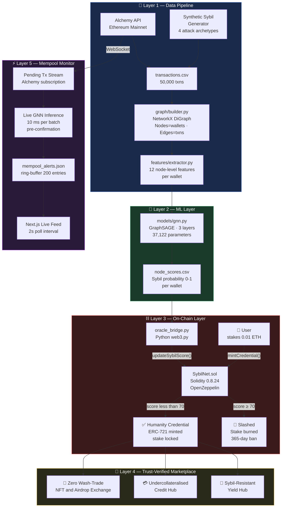

---

## D2 — End-to-End Data Pipeline

```mermaid
flowchart LR
    subgraph INGEST["Step 1 — Ingest"]
        A["Alchemy API\neth_getLogs"] --> C["transactions.csv\n50k rows"]
        B["Synthetic Sybil\nGenerator"] --> C
    end

    subgraph GRAPH["Step 2 — Build Graph"]
        C --> D["graph/builder.py"]
        D --> E["NetworkX DiGraph\nNodes = wallets\nEdges = txns"]
        E --> F["graph.pkl\nserialised"]
    end

    subgraph FEAT["Step 3 — Extract Features"]
        F --> G["features/extractor.py"]
        G --> H["12 features x N nodes\nRobustScaler normalised"]
        H --> I["features.csv\nnodes.csv · edges.csv"]
    end

    subgraph TRAIN["Step 4 — Train GNN"]
        I --> J["models/gnn.py"]
        J --> K["GraphSAGE\n3-layer SAGEConv"]
        K --> L["sybil_sage.pt\ntrained weights"]
        K --> M["node_scores.csv\nSybil probability per wallet"]
    end

    subgraph ENFORCE["Step 5 — Enforce On-Chain"]
        M --> N["oracle_bridge.py"]
        N -->|"score ≥ 85%"| O["slash()"]
        N -->|"60 to 85%"| P["updateSybilScore()"]
        N -->|"less than 60%"| Q["No action"]
        O --> R["SybilNet.sol\nstake burned · ban applied"]
        P --> R
    end

    subgraph VIZ["Step 6 — Visualise"]
        F --> S["visualization/viewer.py"]
        S --> T["graph_visualization.html\nPyVis interactive"]
    end

    style INGEST fill:#eef2ff,stroke:#5c8ae6
    style GRAPH fill:#eefff2,stroke:#4caf7d
    style FEAT fill:#fff8ee,stroke:#e6a34c
    style TRAIN fill:#ffeef2,stroke:#e64c7d
    style ENFORCE fill:#f2eeff,stroke:#7d4ce6
    style VIZ fill:#eefff8,stroke:#4ce6b4
```

---

## D3 — GraphSAGE Neural Network Architecture

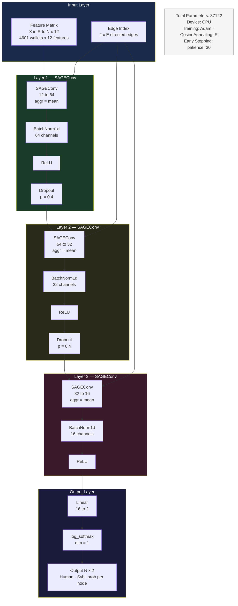

---

## D4 — Sybil Attack Graph Patterns

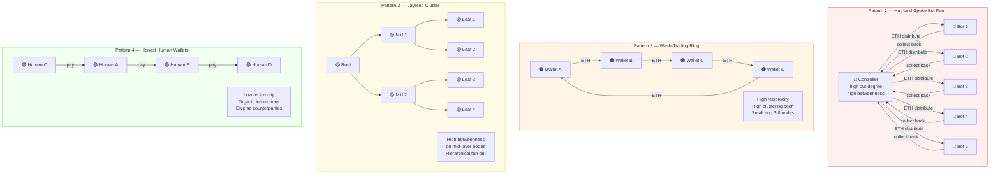

---

## D5 — Smart Contract Credential State Machine

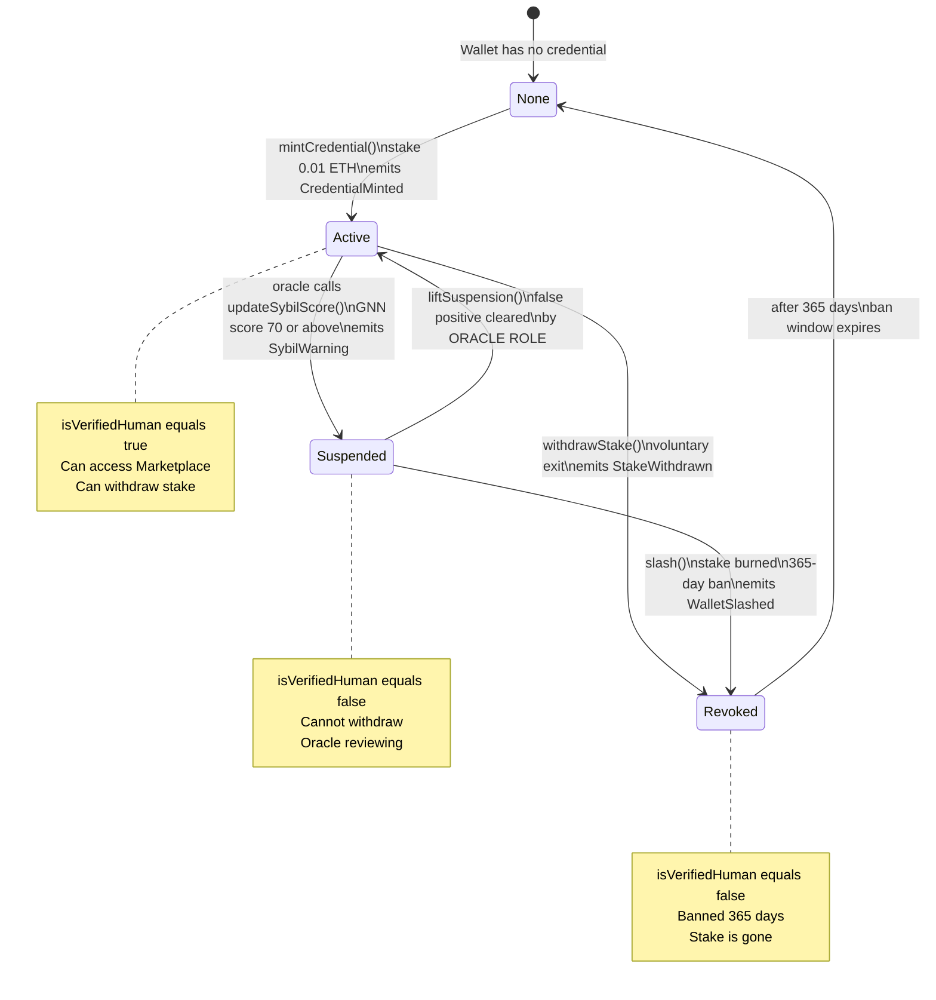

---

## D6 — Smart Contract Role Permissions

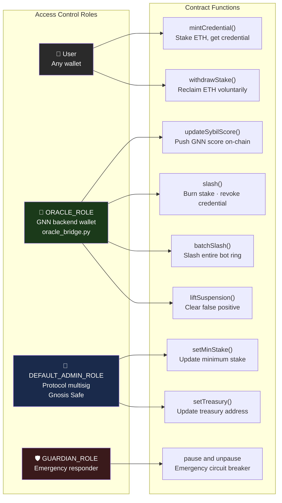

---

## D7 — Oracle Bridge Sequence

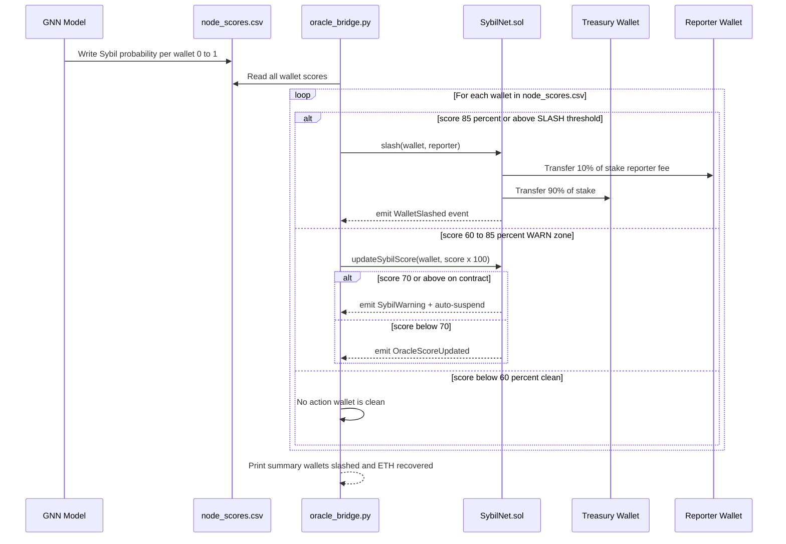

---

## D8 — Mempool Monitor Pipeline

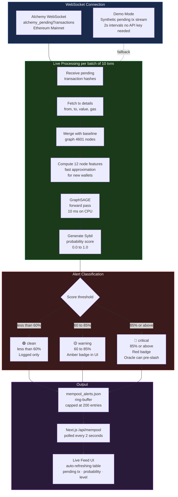

---

## D9 — zk-SNARK Proof Flow

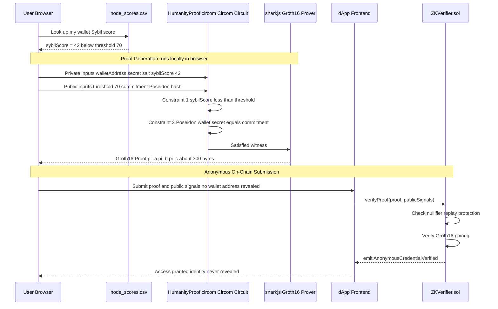

---

## D10 — Cross-Chain Bridge Topology

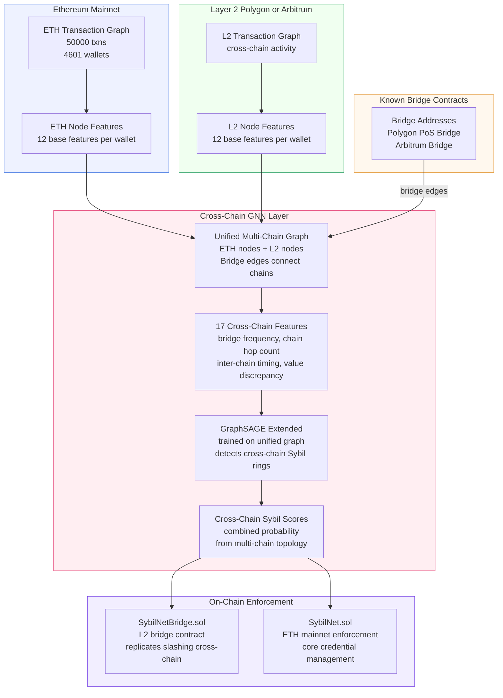

---

## D11 — Governance & DAO Lifecycle

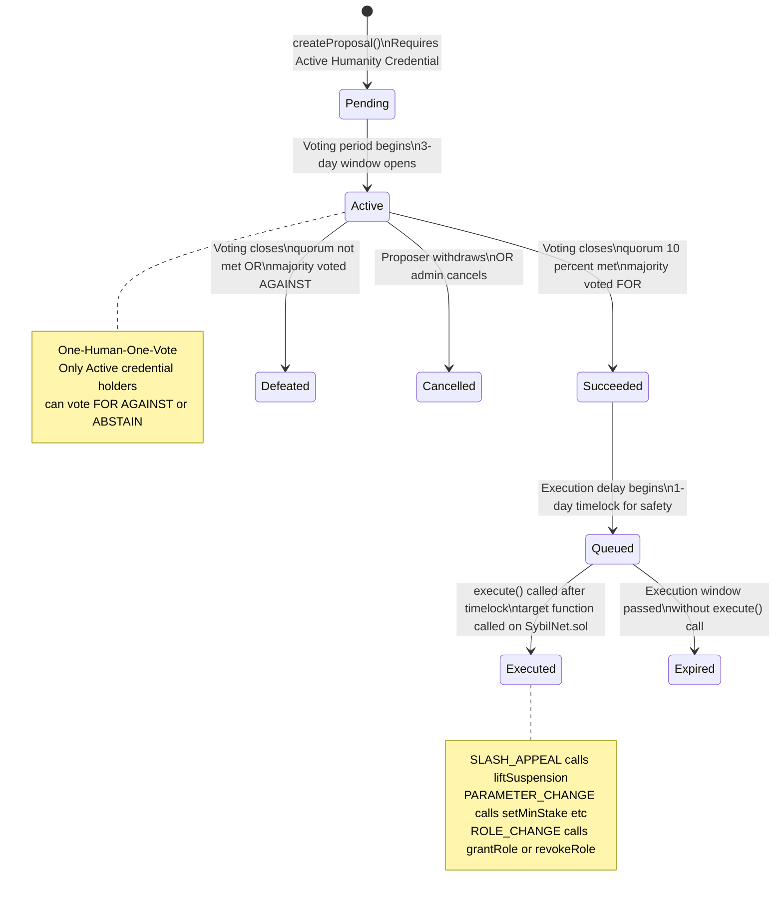

---

## D12 — Trust-Verified Marketplace Ecosystem

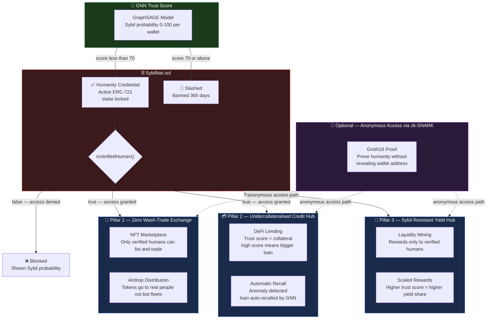

---

## D13 — 8-Week Project Roadmap (Gantt)

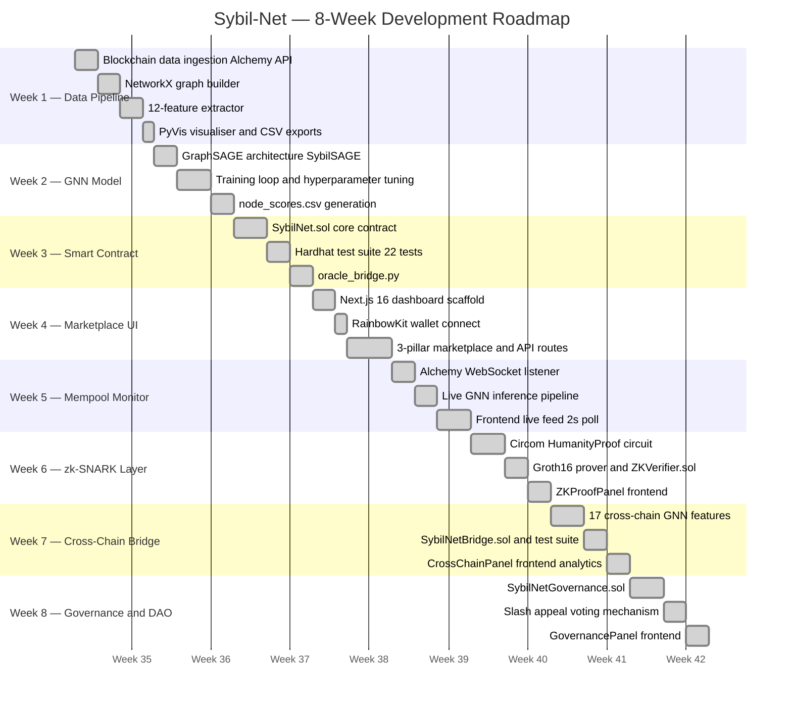

---

## D14 — Slash Fund Distribution

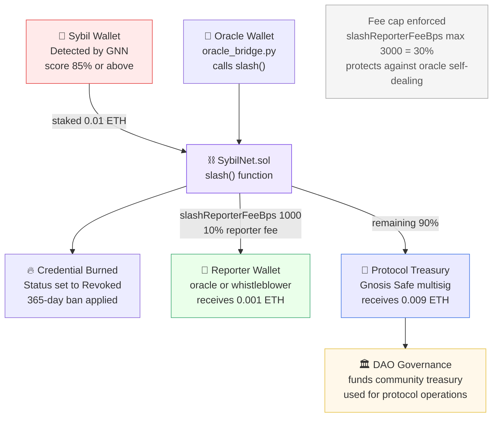

---

## D15 — Feature Extraction Pipeline

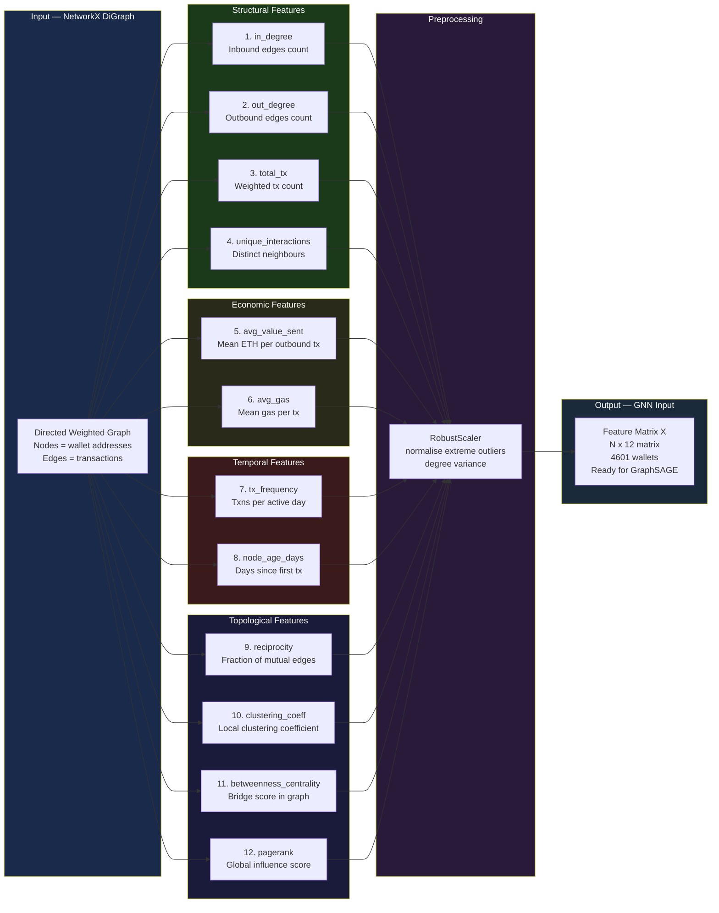

---

> **Tips for draw.io:**
> - Go to `Extras` → `Edit Diagram` → paste the full mermaid block (including ` ```mermaid ` fences)
> - After importing, select all → `Format` → `Auto-layout` for best spacing
> - Use `Edit Style` on any node to change colours, fonts, and borders
> - Export as **SVG** for crisp vector output in your report PDF
> - Export as **PNG 300 DPI** for Word or PowerPoint embedding
> - For the Gantt chart (D13), draw.io will render it as a timeline bar chart — use `View` → `Fit Page` after import
