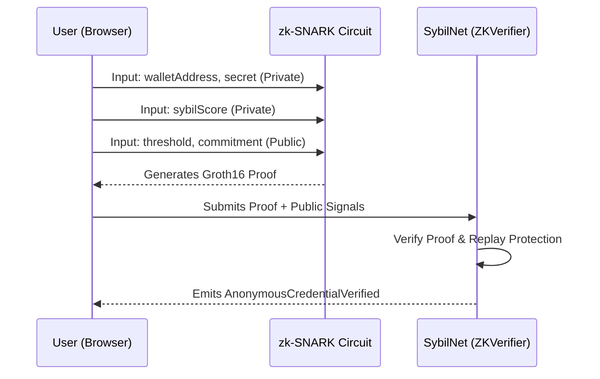

# Week 6: zk-SNARK Integration 🔐

## The Privacy Problem
In the previous weeks, we built a robust Graph Neural Network (GNN) that scores wallets on their probability of being a Sybil attacker (bot). However, this meant that to use a dApp, a user had to reveal their wallet address so the dApp could check their score. 

This creates a privacy issue: users shouldn't have to expose their entire transaction history just to prove they are human.

## The zk-SNARK Solution
We integrated a zero-knowledge proof (zk-SNARK) system using **Circom** and **snarkjs**. 

Instead of revealing their wallet address to a dApp, a user generates a cryptographic proof locally on their device. This proof says:
> "I know a secret that corresponds to a wallet address whose Sybil score is below the threshold of 70. Here is the mathematical proof."

The dApp (or a smart contract) can verify this proof without ever knowing the user's actual wallet address.

## Architecture



## Security Properties
1. **Zero-Knowledge**: The proof does not reveal the `walletAddress`, `secret`, or `sybilScore`.
2. **Succinctness**: The proof is small (a few hundred bytes) and fast to verify on-chain (constant time).
3. **Replay Protection**: The `ZKVerifier` smart contract records a nullifier (hash of the proof) to ensure the same proof cannot be submitted twice.

## Running the zk-SNARK Flow

1. **Setup the Circuit**:
   ```bash
   cd zkp
   ./setup.sh
   ```
   This will compile the `HumanityProof.circom` circuit, run the Powers of Tau ceremony, and generate the proving/verification keys.

2. **Generate a Proof**:
   You can use the Python helper script to read a wallet's score and generate a proof:
   ```bash
   python zkp/scripts/prove_humanity.py --wallet 0xYOUR_WALLET --secret 12345
   ```
   This outputs `proof.json` and `public.json` in `zkp/proofs/`.

3. **Frontend Integration**:
   The `ZKProofPanel` React component in the Next.js app allows users to locally generate these proofs directly in their browser before submitting them on-chain.

## Limitations & Future Work
- The current implementation is a local setup. For production, a multi-party computation (MPC) Trusted Setup is required.
- The browser integration currently simulates proof generation. Integrating `snarkjs` directly into the Next.js frontend will allow true in-browser proving.
