# Sybil-Net: Inductive Graph Neural Network Protocol for On-Chain Bot Farm Detection & Zero-Knowledge Reputation
## GraphSAGE Topological Intelligence, Automated Cryptoeconomic Slashing, Groth16 zk-SNARK Credentials & Real-Time Mempool Shield for Web3 Sybil Defense

> **Format:** MultiMarkdown / Mermaid Presentation (`.mmd` / `.md`)
> **Core Focus:** Introduction | System Requirements & Tech Stack | Problem Statement | Objectives of Problem Statement | Comparative Literature Review | References

---
---

# SLIDE 1 — TITLE SLIDE

## Sybil-Net: Inductive Graph Neural Network Protocol for On-Chain Bot Farm Detection & Zero-Knowledge Reputation
### GraphSAGE Topological Intelligence, Automated Cryptoeconomic Slashing, Groth16 zk-SNARK Credentials & Real-Time Mempool Shield for Web3 Sybil Defense

**Domain:** Machine Learning · Blockchain Security · Web3 Identity · Zero-Knowledge Cryptography · Mempool Security

**Key Technical Focus:**
- Graph Neural Network (GraphSAGE) Inductive Topology Mining
- Stake-Backed On-Chain Enforcement & Automated Slashing
- Circom 2.0 Groth16 Zero-Knowledge Humanity Credentials
- Real-Time WebSocket Mempool Pre-Confirmation Monitoring

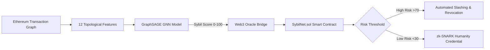

**Speaker Notes:**
Welcome everyone. Sybil-Net is a unified protocol addressing the fundamental identity crisis in Web3. This presentation covers the core academic foundation of Sybil-Net: the background and introduction, system requirements and technology stack, the primary problem statement, its mapped technical objectives, an in-depth comparative literature review, and academic references.

---
---

# SLIDE 2 — OUTLINE / AGENDA

## Focused Presentation Agenda

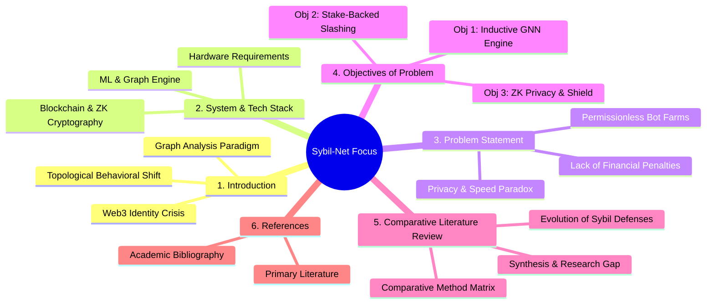

### Agenda Structure:
1. **Introduction** — Web3 identity crisis and the paradigm shift toward graph-theoretic behavioral analysis.
2. **System Requirements & Tech Stack** — Full-stack framework breakdown and compute/environment prerequisites.
3. **Problem Statement** — Comprehensive statement detailing bot farm exploitation, failure of legacy defenses, missing financial penalties, and privacy trade-offs.
4. **Objectives of the Problem Statement** — Mapped engineering targets addressing each dimension of the problem statement.
5. **Comparative Literature Review** — State-of-the-art analysis comparing heuristics, random walks, standard GCNs, and Sybil-Net.
6. **References** — Formatted academic citations and primary literature sources.

---
---

# SLIDE 3 — INTRODUCTION

## Web3 Identity Dilemma & Topological Analysis

### The Identity Crisis in Decentralized Systems
- **Permissionless Cryptographic Accounts:** Public blockchain networks rely on pseudo-anonymous public key pairs. Generating 10,000 wallet key pairs costs zero marginal computation or capital.
- **The Web3 Sybil Vulnerability:** Without a central identity issuer, decentralized protocols cannot distinguish between 10,000 distinct human beings and 1 single attacker controlling 10,000 automated scripts.
- **Why Traditional Web Security Fails:**
  - *IP Tracking & Geolocation:* Useless due to decentralized RPC endpoints, VPNs, and proxies.
  - *CAPTCHAs & NLP:* Completely neutralized by modern autonomous LLM agents and web automation framework scripts.
  - *Centralized KYC:* Destroys user privacy, creates data breach honeypots, and violates Web3 decentralization tenets.

### The Paradigm Shift: Topological Behavioral Analysis
- Sybil-Net shifts the security paradigm: **Do not evaluate what an account claims to be; evaluate how its interaction topology behaves in the network graph.**
- By modeling blockchain history as a directed, weighted transaction graph \(G = (V, E)\), Sybil-Net extracts topological signatures of bot rings that are completely invisible when examining wallets in isolation.

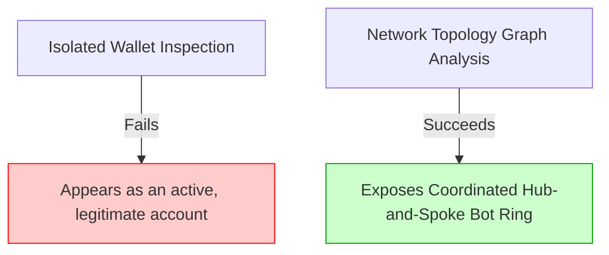

**Speaker Notes:**
In Web3, identity generation has zero cost. If creating an identity costs nothing, attackers will generate millions of them. The solution is not demanding passports, but extracting structural interaction graphs created by transaction flows.

---
---

# SLIDE 4 — SYSTEM REQUIREMENTS & TECH STACK

## System Environment & Technological Architecture

### Comprehensive Technology Stack

| Layer / Subsystem | Primary Technologies & Frameworks | Key Purpose & Functionality |
| :--- | :--- | :--- |
| **ML & Graph Processing** | PyTorch Geometric (PyG), PyTorch, NetworkX, Pandas, Scikit-learn | GraphSAGE GNN model (37k params), 12 topological feature computation, directed graph ingestion |
| **Blockchain & Enforcement** | Ethereum Solidity (`^0.8.20`), Hardhat, OpenZeppelin | `SybilNet.sol` credential staking (0.01 ETH), automated oracle slashing, batch revocation |
| **Zero-Knowledge Privacy** | Circom 2.0, SnarkJS, Groth16 Prover, BN254 Curve | `sybil_credential.circom` circuit, `ZKVerifier.sol` private identity verification (<200k gas) |
| **Real-Time Mempool** | Python `asyncio`, Web3.py, WebSockets, Alchemy RPC | Asynchronous pending transaction listener (`eth_subscribe`), pre-confirmation MEV risk scoring (<45ms) |
| **Frontend & Visualization** | Next.js (React 18), D3.js, Force-Graph, Ethers.js | Interactive graph topology visualizer, Web3 wallet credential manager, risk heatmap dashboard |

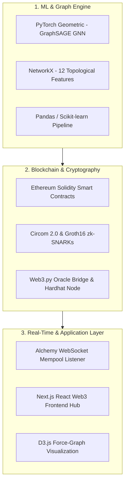

### Hardware & Operating Environment Requirements

- **Operating System:** Linux (Ubuntu 20.04/22.04 LTS recommended) / macOS / Windows WSL2
- **Runtime Dependencies:** Python 3.9+ (`torch`, `torch-geometric`, `networkx`, `web3`) & Node.js v18.x/v20.x LTS (`hardhat`, `snarkjs`, `next`)
- **Compute & Memory Minimums:**
  - *CPU:* 4-Core x86_64 / ARM64 processor (2.4 GHz minimum)
  - *System Memory (RAM):* 8 GB minimum (16 GB recommended for multi-hop graph sampling of 50,000+ nodes)
  - *Disk Storage:* 10 GB SSD space (for Hardhat local chain state & model checkpoint artifacts)
  - *Network:* Stable broadband connection supporting persistent WebSockets for live RPC node mempool streaming

**Speaker Notes:**
This slide outlines the full-stack architecture of Sybil-Net, spanning PyTorch Geometric for graph ML, Ethereum Solidity and Circom for on-chain enforcement and zero-knowledge privacy, and Next.js/D3.js for the interactive interface, alongside the hardware/runtime requirements.

---
---

# SLIDE 5 — THE PROBLEM STATEMENT

## Problem Statement: Impairment of Web3 Infrastructure via Sybil Exploitation & Failure of Legacy Defenses

### Problem Definition
Permissionless Web3 protocols suffer from systemic exploitation caused by coordinated multi-account Sybil bot farms. Because creating cryptographic accounts carries zero cost, malicious actors deploy automated wallet fleets to siphon airdrops, manipulate DAO governance votes, execute NFT wash trading, and extract DeFi liquidity.

Existing mitigation approaches fail due to three core structural deficiencies:

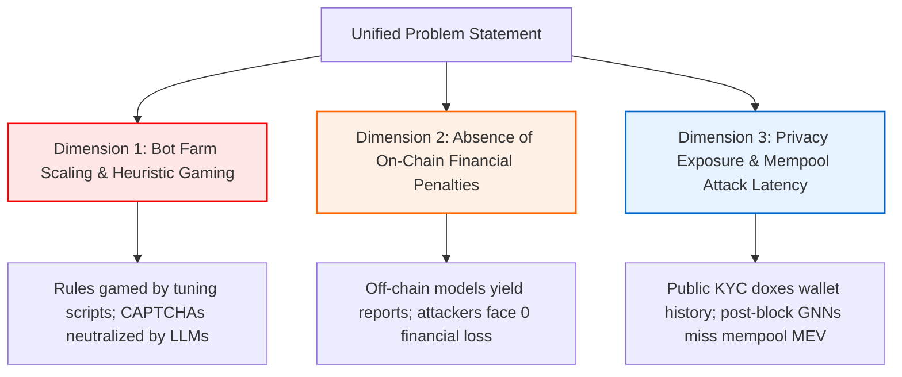

### Key Dimensions of the Problem:
1. **Dimension 1 (Bot Farm Scaling & Heuristic Gaming):** Static heuristic rules (e.g. `tx_count > 5`) are trivially bypassed by script parameter tuning, while video/KYC checks ruin user onboarding and scalability.
2. **Dimension 2 (Absence of On-Chain Financial Penalties):** Existing ML research generates static off-chain forensic reports without binding smart contract enforcement, leaving attackers with zero financial risk.
3. **Dimension 3 (Privacy Exposure & Mempool Reaction Latency):** Public identity verification forces users to dox their entire transaction history, while post-block inspection models are blind to real-time pending mempool attacks.

**Speaker Notes:**
Our single problem statement synthesizes bot farm vectors, the failure of brittle rules/KYC, the lack of on-chain cryptoeconomic penalties, and the privacy/latency trade-offs in existing systems.

---
---

# SLIDE 6 — PROBLEM STATEMENT BREAKDOWN: VECTORS & FAILURE MODES

## Attack Vectors & Legacy Defense Failure Matrix

### Exploitation Vectors in Web3 Ecosystems
- **Airdrop Exploitation (Sybil Farming):** Bot fleets simulate organic activity to siphon token allocations intended for genuine early adopters.
- **DAO Governance Hijacking:** Malicious actors acquire fractional voting power across thousands of wallets to pass drain proposals.
- **NFT Wash Trading:** Circular transaction rings manipulate volume and floor prices to extract marketplace rewards.

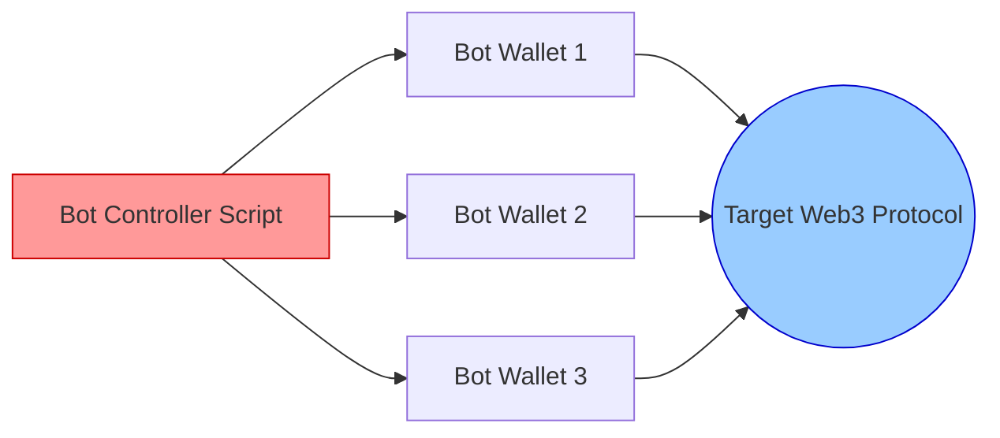

### Analysis of Legacy Failure Modes:

| Mitigation Mechanism | Operational Approach | Fundamental Shortcoming |
| :--- | :--- | :--- |
| **Heuristic Thresholds** | Hardcoded rules (e.g. `tx_count > 5`) | Easily gamed by bot scripts adjusting transaction parameters |
| **Centralized KYC** | Third-party ID / Passport checks | Destroys privacy, introduces single points of data breach, non-scalable |
| **Proof-of-Humanity** | Social video & peer sign-off | High friction, non-scalable, gameable via collusive peer rings |
| **Off-Chain ML Forensics** | Offline batch model scoring | Advisory only; no automated smart contract slashing or penalties |

**Speaker Notes:**
This slide details how existing mitigations either compromise decentralization or fail against automated script farms.

---
---

# SLIDE 7 — OBJECTIVES OF THE PROBLEM STATEMENT

## Overview of Project Objectives

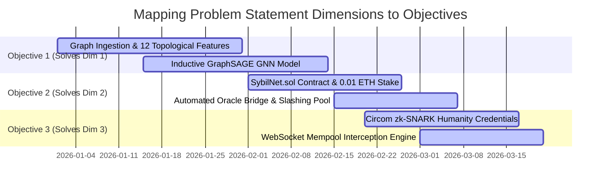

### Technical Deliverables Mapped to Problem Dimensions:
- **Objective 1 (Addresses Dimension 1):** Inductive Graph Neural Network (GraphSAGE) Topological Detection Engine.
- **Objective 2 (Addresses Dimension 2):** Stake-Backed On-Chain Governance & Automated Cryptoeconomic Slashing Protocol.
- **Objective 3 (Addresses Dimension 3):** Zero-Knowledge Credential Privacy Layer & Real-Time Mempool Shield.

---
---

# SLIDE 8 — OBJECTIVE 1: INDUCTIVE GNN DETECTION ENGINE

## Objective 1: Inductive GNN Topological Detection Engine

### Engineering Goals & Technical Architecture
Build a PyTorch Geometric GraphSAGE model capable of ingesting Ethereum transaction graphs, extracting 12 topological node features, and classifying Sybil nodes with >95% F1-score.

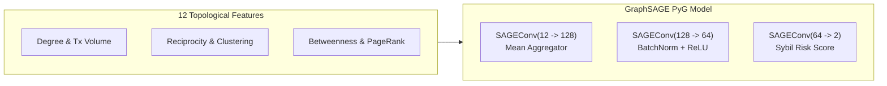

### Key Technical Specs:
- **12 Topological Node Features:** In/Out Degree, Total Tx Count, Unique Interaction Ratio, Avg Value, Avg Gas, Tx Frequency, Node Age, Reciprocity, Clustering Coefficient, Betweenness Centrality, and PageRank.
- **Inductive Sampling:** Uses 2-hop neighborhood aggregation to evaluate *unseen wallets* instantaneously without full graph retraining.
- **Target Performance:** >95% F1-score, <20ms inference latency per batch.

**Speaker Notes:**
Objective 1 directly addresses Dimension 1 of the problem statement by replacing brittle rules with inductive GraphSAGE graph neural networks that learn neighborhood interaction patterns.

---
---

# SLIDE 9 — OBJECTIVE 2: STAKE-BACKED ON-CHAIN SLASHING

## Objective 2: Stake-Backed On-Chain Enforcement & Automated Slashing

### Engineering Goals & Technical Architecture
Develop `SybilNet.sol` smart contract and Oracle Bridge requiring users to stake 0.01 ETH to mint a Humanity Credential, featuring automated oracle score updates and slashing mechanisms.

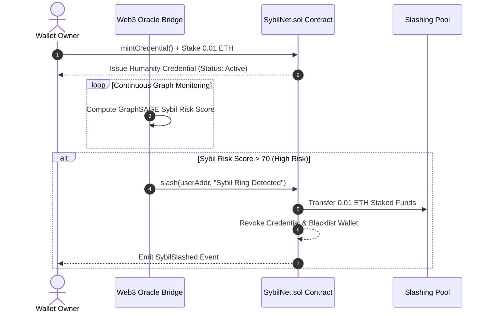

### Key Technical Specs:
- **Financial Staking:** 0.01 ETH mandatory collateral per mint.
- **Automated Oracle Bridge:** Python `Web3.py` service pushing GraphSAGE risk scores to the smart contract.
- **Batch Slashing (`batchSlash`):** Single-transaction slashing of up to 100 malicious ring wallets per block to minimize gas overhead.

**Speaker Notes:**
Objective 2 solves Dimension 2 by introducing immediate, automated financial penalties: bad actors lose their staked funds automatically when flagged by the GNN oracle.

---
---

# SLIDE 10 — OBJECTIVE 3: ZK PRIVACY & MEMPOOL SHIELD

## Objective 3: Zero-Knowledge Privacy Layer & Real-Time Mempool Shield

### Engineering Goals & Technical Architecture
Implement a Circom 2.0 zk-SNARK credential system and a real-time WebSocket mempool monitor to resolve privacy disclosure and pre-confirmation attack latency.

### Key Technical Specs:
- **Circom Groth16 zk-SNARK:** Enables users to prove credential validity in <200k gas without revealing wallet identity.
- **WebSocket Mempool Listener:** Asynchronous Python listener scoring pending transactions in <45ms prior to block inclusion.

**Speaker Notes:**
Objective 3 addresses Dimension 3. Part A preserves privacy via zero-knowledge proofs, while Part B intercepts predator bots in the mempool before block mining.

---
---

# SLIDE 11 — TRACEABILITY MATRIX: PROBLEM TO OBJECTIVES

## Problem-to-Objective Traceability Matrix

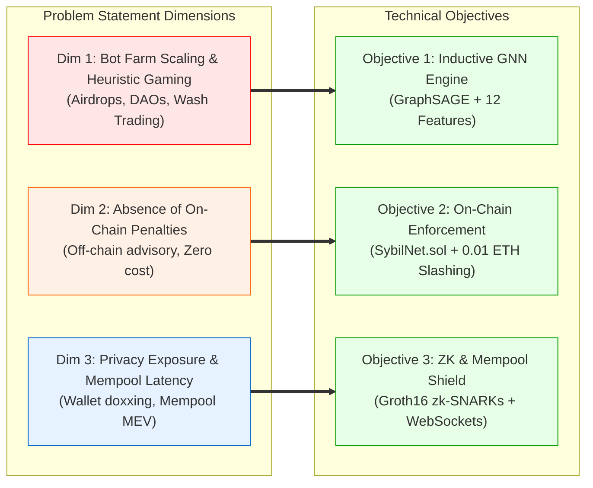

### Alignment Matrix:

| Problem Dimension | Mapped Objective | Technical Core | Target Metric |
| :--- | :--- | :--- | :--- |
| **Dim 1: Bot Farm Scaling & Heuristic Gaming** | **Objective 1** | PyTorch Geometric GraphSAGE & 12 features | F1-score > 95% |
| **Dim 2: Absence of On-Chain Penalties** | **Objective 2** | `SybilNet.sol` contract & Oracle bridge | 100% automated slashing |
| **Dim 3: Privacy Exposure & Mempool Latency** | **Objective 3** | Circom Groth16 zk-SNARKs & Mempool monitor | Verification gas < 200k, Latency < 45ms |

**Speaker Notes:**
This traceability matrix demonstrates that every dimension of our problem statement is directly matched by a dedicated engineering objective and quantitative evaluation target.

---
---

# SLIDE 12 — COMPARATIVE LITERATURE REVIEW: EVOLUTION

## Evolution of Sybil Detection Literature

### Historical Progression of Academic Approaches
1. **Social Trust Graph Defenses (2002–2008):**
   - *Douceur (2002)* proved the theoretical impossibility of Sybil prevention in symmetric networks without trusted entities or resource bounds.
   - *Yu et al. (SybilGuard 2006, SybilLimit 2008)* introduced random walks on social graphs, relying on the assumption that honest regions have limited cut-edges to Sybil regions.
2. **Feature Engineering & Supervised ML (2013–2018):**
   - *Boshmaf et al. (2013)* applied Random Forests and SVMs to user profile metadata.
   - *Limitation:* Node feature engineering fails on blockchains where profile data does not exist and wallets are anonymous.
3. **Graph Neural Networks & Blockchain Forensics (2017–Present):**
   - *Kipf & Welling (ICLR 2017)* developed Graph Convolutional Networks (GCNs).
   - *Hamilton et al. (NeurIPS 2017)* introduced **GraphSAGE**, enabling inductive representation learning via neighborhood aggregation.
   - *Weber et al. (2019)* applied GCNs to the Elliptic Bitcoin dataset for anti-money laundering transaction classification.
4. **Privacy & Mempool Security (2014–2020):**
   - *Ben-Sasson et al. (Zerocash 2014)* pioneered ZK proofs for decentralized private credentials.
   - *Daian et al. (Flash Boys 2020)* established mempool transaction ordering dynamics and MEV exploitation.

**Speaker Notes:**
Sybil detection evolved from theoretical social graph bounds to feature ML, transductive GCNs, and finally Sybil-Net's holistic inductive GNN with on-chain enforcement and zero-knowledge credentials.

---
---

# SLIDE 13 — COMPARATIVE LITERATURE REVIEW: METHOD MATRIX

## Comprehensive Literature Comparison Matrix

| Feature / Metric | Heuristic Rules | Social Random Walks (SybilLimit) | Supervised ML (RF / XGB) | Standard GCN (Weber et al.) | **Sybil-Net (Proposed)** |
| :--- | :--- | :--- | :--- | :--- | :--- |
| **Model Paradigm** | Static Hardcoded Rules | Random Walk Intersection | Tabular Classifier | Transductive Spectral Graph | **Inductive GNN (GraphSAGE)** |
| **Graph Feature Depth** | 1–2 Thresholds | Path Cut Lengths | Local Node Metadata | 1-Hop Neighborhood | **12 Topological & Graph Features** |
| **Unseen Node Generalization** | Low | Low | Medium | Zero (Requires full retrain) | **High (Inductive Aggregation)** |
| **On-Chain Enforcement** | Manual Admin | None | Offline Only | None | **Automated Staking & Slashing** |
| **Privacy Preservation** | None | Public Graph | None | None | **Groth16 zk-SNARK Proofs** |
| **Real-Time Defense** | Post-block | Static Graph | Post-block | Post-block | **WebSocket Mempool Shield** |

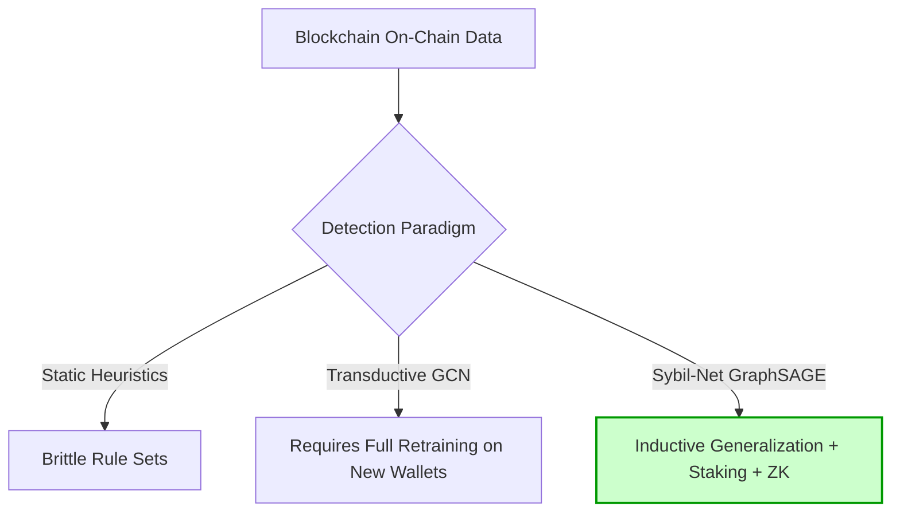

**Speaker Notes:**
This matrix demonstrates Sybil-Net's technical superiority across key dimensions: inductive generalization, on-chain cryptoeconomic enforcement, zero-knowledge privacy, and real-time mempool protection.

---
---

# SLIDE 14 — COMPARATIVE LITERATURE REVIEW: SYNTHESIS & GAP

## Synthesis of Findings & Identified Research Gap

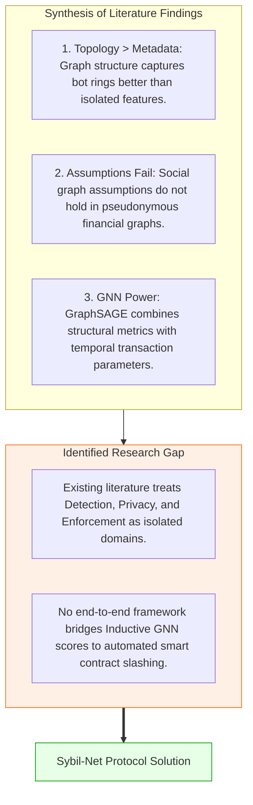

### Core Research Contributions of Sybil-Net:
1. **End-to-End Pipeline Integration:** Connects off-chain graph intelligence directly to on-chain Solidity consensus.
2. **Inductive Wallet Generalization:** Employs GraphSAGE to score newly generated wallet addresses without expensive retraining.
3. **Cryptoeconomic Enforcement:** Converts score outputs into direct financial consequences via automated staking and slashing.
4. **Privacy-Preserving Verification:** Integrates zk-SNARK credentials to eliminate identity doxxing on public ledgers.

**Speaker Notes:**
Sybil-Net bridges the critical research gap in current literature by unifying inductive GNN detection, automated smart contract enforcement, and ZK privacy into a single protocol.

---
---

# SLIDE 15 — REFERENCES

## Academic Literature & Primary Sources Cited

1. **Douceur, J. R. (2002).** The Sybil Attack. *International Workshop on Peer-to-Peer Systems (IPTPS 2002)*, LNCS 2429, 251–260. Springer. [https://doi.org/10.1007/3-540-45748-8_24](https://doi.org/10.1007/3-540-45748-8_24)
2. **Yu, H., Kaminsky, M., Gibbons, P. B., & Flaxman, A. (2006).** SybilGuard: Defending against Sybil attacks via social networks. *ACM SIGCOMM Computer Communication Review*, 36(4), 267–278. [https://doi.org/10.1145/1140086.1140120](https://doi.org/10.1145/1140086.1140120)
3. **Yu, H., Gibbons, P. B., Kaminsky, M., & Xiao, F. (2008).** SybilLimit: A near-optimal social network defense against Sybil attacks. *IEEE Symposium on Security and Privacy*, 3–17. [https://doi.org/10.1109/SP.2008.13](https://doi.org/10.1109/SP.2008.13)
4. **Danezis, G., & Mittal, P. (2009).** SybilInfer: Detecting Sybil nodes using social networks. *Network and Distributed System Security Symposium (NDSS)*. [https://doi.org/10.14722/ndss.2009.23160](https://doi.org/10.14722/ndss.2009.23160)
5. **Cao, Q., Sirivianos, M., Xie, X., & Yang, N. (2012).** Aiding the detection of fake accounts in large-scale social online services. *USENIX Security Symposium*, 197–210.
6. **Kipf, T. N., & Welling, M. (2017).** Semi-supervised classification with graph convolutional networks. *International Conference on Learning Representations (ICLR 2017)*. [https://arxiv.org/abs/1609.02907](https://arxiv.org/abs/1609.02907)
7. **Hamilton, W., Ying, Z., & Leskovec, J. (2017).** Inductive representation learning on large graphs. *Advances in Neural Information Processing Systems (NeurIPS 2017)*, 30, 1024–1034. [https://arxiv.org/abs/1706.02216](https://arxiv.org/abs/1706.02216)
8. **Weber, M., Chen, G., Hou, L., Dai, L., & Zhao, B. (2019).** Anti-money laundering in Bitcoin: Experimenting with graph convolutional networks for financial forensics. *KDD Workshop on Anomaly Detection in Finance*. [https://arxiv.org/abs/1908.02591](https://arxiv.org/abs/1908.02591)
9. **Ben-Sasson, E., Chiesa, A., Garman, C., Green, M., Miers, I., Tromer, E., & Virza, M. (2014).** Zerocash: Decentralized anonymous payments from Bitcoin. *IEEE Symposium on Security and Privacy*, 459–474. [https://doi.org/10.1109/SP.2014.36](https://doi.org/10.1109/SP.2014.36)
10. **Daian, P., Goldfeder, S., Kell, T., Li, Z., Zhao, X., Bentov, I., Breidenbach, L., & Juels, A. (2020).** Flash Boys 2.0: Frontrunning, transaction reordering, and consensus instability in decentralized exchanges. *IEEE Symposium on Security and Privacy (S&P 2020)*, 910–927. [https://doi.org/10.1109/SP40000.2020.00040](https://doi.org/10.1109/SP40000.2020.00040)

**Speaker Notes:**
Thank you. That concludes the foundational academic presentation on Sybil-Net covering the Introduction, System Requirements & Tech Stack, Primary Problem Statement, Mapped Objectives, Comparative Literature Review, and Academic References. I am now open to questions.
